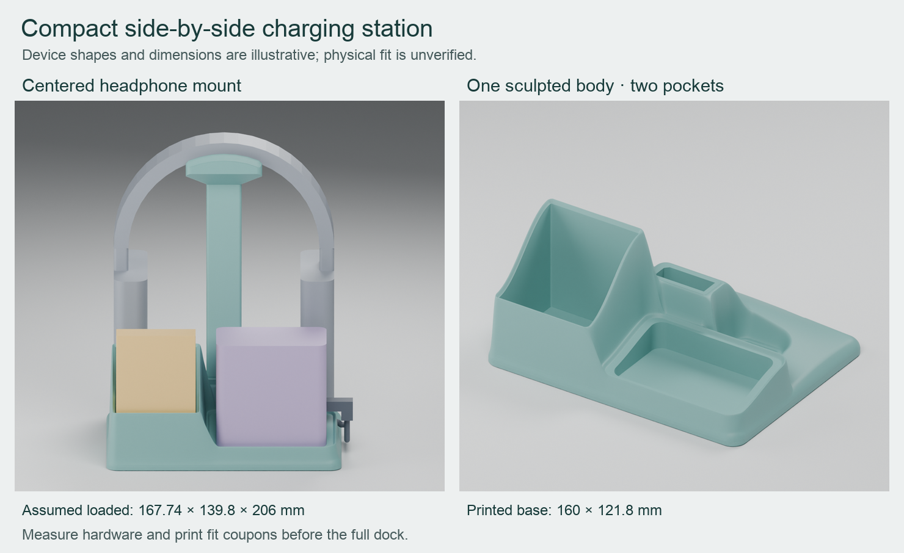

# Perch

A compact, 3D-printable tabletop home for a **Yoto Mini in its Adventure Jacket**,
roughly **20 loose cards**, and **kids' headphones**. Cards sit on the left, the
player on the right, with a centered headphone stand behind them. Soft, rounded
surfaces join the holders and stand socket into one sculpted base.

**[Visit the Perch website](https://echoz.github.io/Perch/)** for a
closer look at the design, print downloads and editable CAD.



The base measures **160 × 121.8 mm**. One shared cable passage routes two USB-C
leads to charge the player and headphones; each device is plugged in manually.

**Current status: W0.1 print candidate.** The card compartment has accepted
physical-fit feedback. The revised player pocket uses the selected dimensions,
but the complete station still needs physical fit and use checks.

## Download the print files

**[Download the complete print ZIP](https://github.com/echoz/Perch/releases/download/w01-candidate/yoto-concept-print-parts.zip)**

It contains the three main print parts, fit samples, assembly guide, previews
and recorded geometry checks. The [candidate release](https://github.com/echoz/Perch/releases/tag/w01-candidate)
also provides these smaller packages:

| Download | Contents |
| --- | --- |
| [Mini width samples](https://github.com/echoz/Perch/releases/download/w01-candidate/yoto-mini-width-tests.zip) | Selected W0.1 pocket and the retained W0.2 alternative |
| [Original fit samples](https://github.com/echoz/Perch/releases/download/w01-candidate/yoto-fit-tests.zip) | Earlier Mini pocket trials and the shared two-cable passage test |

If you already printed the preceding candidate's mast halves, keep them:
**only `base.stl` changed** for the W0.1 fit revision.

## Print and assemble

The intended setup is a **Bambu Lab X1C, stock 0.4 mm nozzle, and PLA**. A specific
plate, filament product and slicer profile have not been established.

1. Extract the complete ZIP and read `READ-BEFORE-PRINTING.md`. Use **100% scale**;
   resizing changes the selected player fit, card cavity and mast joint together.
2. Check the small cable, split-joint, socket and saddle samples with the actual
   cables, fasteners and headphones. The card cavity is unchanged from the
   accepted print; the Mini width samples are retained for reference or a changed
   printer/material/profile.
3. Slice the three main files using the orientations below. Inspect the base's
   cable bridge and the mast halves' bores, recesses and saddle edges in the slicer.
   Digital checks do not establish support-free printing.
4. Join the mast halves with **three M3×20 socket-cap screws** (DIN 912/ISO 4762)
   and **three M3 full hex nuts** (DIN 934), using a **2.5 mm hex driver**. Prove
   the joint dry before optionally adding silicone along the exterior seam.
   Keep the mating faces and socket clear. Install the mast and thread both leads,
   then check player removal, charging access, headphone retention and stability.

| Main print file | Bed orientation |
| --- | --- |
| `base.stl` | Flat underside down |
| `mast_left.stl` | Supplied flat mating face down |
| `mast_right.stl` | Supplied flat mating face down |

`mast.stl`, assembled meshes and device references are not print parts for this
split build. The full [CAD and assembly guide](cad/README.md) covers the mechanical
connection, fit samples, optional silicone, cable routing and physical checks.

## Fit and compatibility

| Item | Current dimensions or evidence |
| --- | --- |
| Jacketed Mini, measured seated section | 75.08 mm wide × 44.91 mm deep |
| Selected Mini opening | 75.28 × 45.51 mm, with 6.3 mm inside corner radius |
| Mini clearance | 0.1 mm per side across the width; 0.3 mm per side front-to-back |
| Card opening | 55.4 × 49.6 mm; accepted card fit preserved |
| Headphones | JBL Junior 470NC used as the design reference; actual hanging shape and headband fit remain unverified |
| Charging cables | Two right-angle USB-C plugs; their body dimensions and bends still need checking |

The Mini's width and depth allowances are independent. The original 0.3 mm sample
received physical-fit feedback, and W0.1 was subsequently selected. That selection
does not establish full-height removal or charging access in the revised base.
The Mini's height and exact jacket edge profile also remain unmeasured.

## Edit and rebuild

[`cad/compact_dock.scad`](cad/compact_dock.scad) is the authoritative model, in
millimetres. [`cad/mini_width_tests.scad`](cad/mini_width_tests.scad) generates the
separate width samples. Blender scenes are derived review views. The default
`side` layout is the current design; `rear` is a historical comparison.

These commands use the installed OpenSCAD and Blender applications on this Mac.
Run from the project root. Application execution may require the host's normal
approval because these applications do not initialize inside the restricted shell.

```sh
python3 scripts/build_concept.py
/Applications/Blender.app/Contents/MacOS/Blender --background --factory-startup --python scripts/inspect_meshes.py -- exports/concept
/Applications/Blender.app/Contents/MacOS/Blender --background --factory-startup --python scripts/render_preview.py -- .
```

For the comparison, export with `--layout rear --output exports/rear-comparison`,
inspect that directory, and render with `--exports exports/rear-comparison
--previews previews/rear-comparison` after the root argument. The image composition
script uses Python with Pillow installed: `python3 scripts/compose_preview.py`.

For the selected width sample, export the supplementary entrypoint separately:

```sh
mkdir -p exports/mini-width-tests
/Applications/OpenSCAD.app/Contents/MacOS/OpenSCAD --hardwarnings --backend Manifold --export-format binstl -D 'part="mini_width_0_1"' -o exports/mini-width-tests/mini_width_0_1.stl cad/mini_width_tests.scad
```

Use `mini_width_0_2` for the alternative or `mini_width_tests` for both. Preserve
100% scale. These commands reflect the tested local Mac setup; OpenSCAD must
support the Manifold backend, Blender supplies its Python modules, and Pillow is
needed only for the composed overview. Other platforms are not verified.

## Validation and version control

Git retains the editable CAD, documentation, scripts, compact evidence JSON and
selected documentation figures. Generated STL meshes, ZIPs, Blender scenes and
backups, other renders, logs, slicer jobs and local environments are ignored;
existing ignored files remain on disk. Checked print ZIPs live in tagged GitHub
candidate releases rather than Git history.

Current fit evidence is recorded in
[`selected-mini-fit-checks.json`](exports/concept/selected-mini-fit-checks.json)
and the [independent review](exports/concept/independent-mini-fit-review.json).
The [manifest](exports/concept/manifest.json) records source and mesh hashes;
[mesh checks](exports/concept/mesh-checks.json) cover topology and modeled
interference. Earlier reports retain their original revision scope.

These are digital checks, not proof of real-device fit, print strength, cable
flexibility or loaded stability. Rebuilding does not recreate independent reviews
or bespoke historical audits. ZIP packaging and width-preview generation are not
yet a complete automated release pipeline. Preserve published candidate assets;
use a new tag for a future checked print package.

## Project website

The public [Perch website](https://echoz.github.io/Perch/) lives in `docs/`.
GitHub Pages publishes that directory from `main`; `.nojekyll` keeps it a plain
static site. The print packages stay in their candidate release and the page
links to the matching editable CAD snapshot.

To preview it locally, run `python3 -m http.server 8773 --bind 127.0.0.1 --directory docs`
from this repository, then open `http://127.0.0.1:8773/`. Keep asset links relative
so they work under the `/Perch/` project path. Check phone and desktop layouts,
keyboard navigation and download links before publishing changes. Keep physical
fit status aligned with the CAD guide; renders are not proof of device fit.
